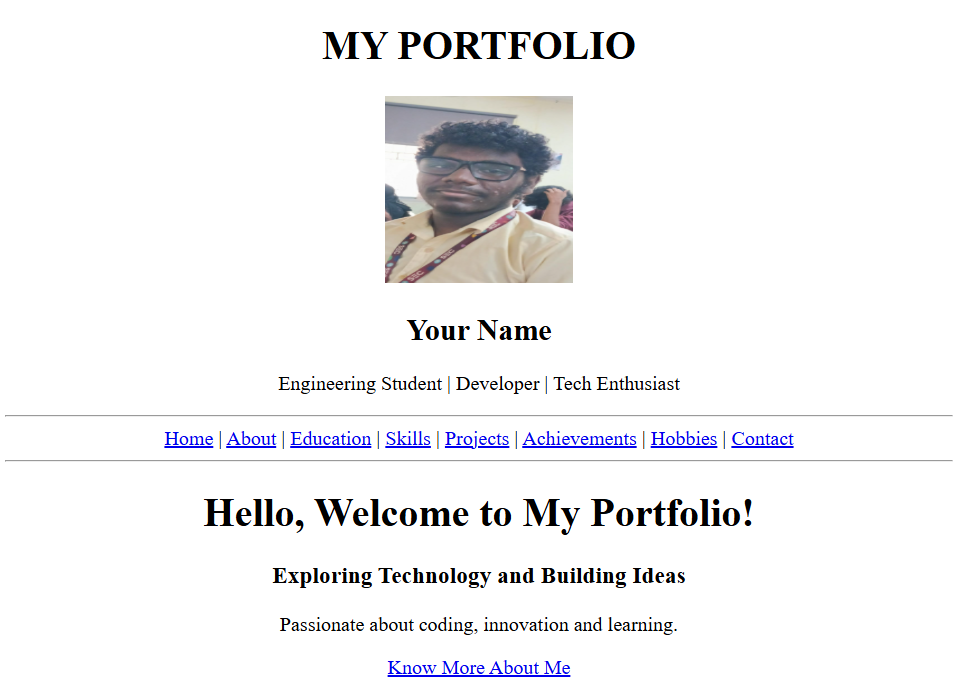
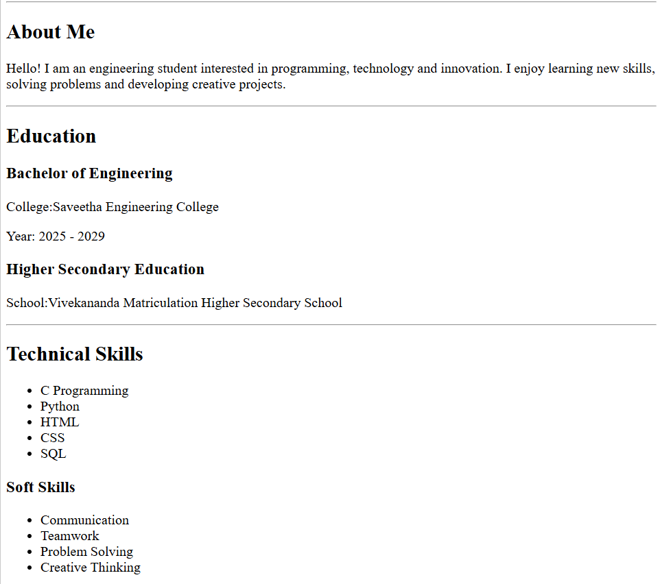
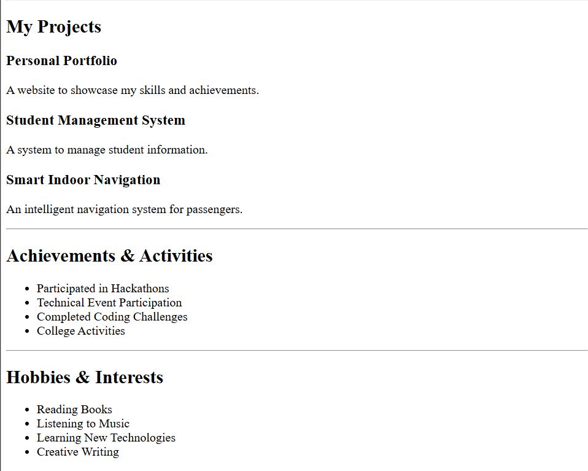
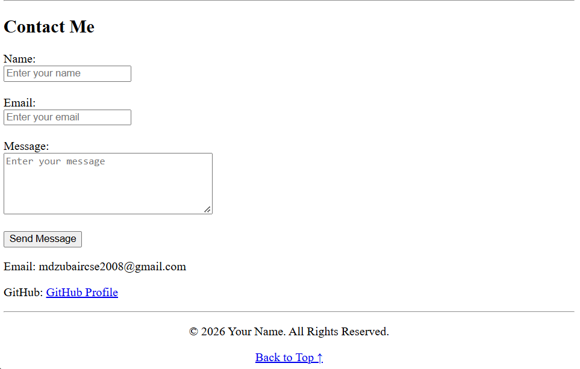

# Ex01 Portfolio
## Date: 31/10/2026

## AIM
To create a Portfolio using HTML and CSS.

## ALGORITHM
### STEP 1
Create an HTML file (index.html)

### STEP 2
Create a CSS file (style.css)

### STEP 3
Include a navigation bar with links to different sections.

### STEP 4
Add structured sections for introduction, about, projects, and contact details.

### STEP 5
Define global styles for fonts, colors, and layout.

### STEP 6
Style the header, navigation bar, and sections.

### STEP 7
Use Flexbox or CSS Grid for layout design.

### STEP 8
Add hover effects and transitions for interactivity.

### STEP 9
Add Images and Media.

### STEP 10
Use optimized images for a professional look.

### STEP 11
Open the HTML file in a browser to check layout and functionality.

### STEP 12
Fix styling issues and refine content placement.

### STEP 13
Deploy the Portfolio.

### STEP 14
Upload to GitHub Pages for free hosting.

## PROGRAM
```

<!DOCTYPE html>
<html>
<head>
    <title>My Portfolio</title>
</head>

<body>

    <header>
        <center>
            <h1>MY PORTFOLIO</h1>
            
            <h2>Your Name</h2>
            <p>Engineering Student | Developer | Tech Enthusiast</p>
        </center>
    </header>

    <hr>

    <nav>
        <center>
            <a href="#home">Home</a> |
            <a href="#about">About</a> |
            <a href="#education">Education</a> |
            <a href="#skills">Skills</a> |
            <a href="#projects">Projects</a> |
            <a href="#achievements">Achievements</a> |
            <a href="#hobbies">Hobbies</a> |
            <a href="#contact">Contact</a>
        </center>
    </nav>

    <hr>

    <main>

        <section id="home">
            <center>
                <h1>Hello, Welcome to My Portfolio!</h1>
                <h3>Exploring Technology and Building Ideas</h3>
                <p>Passionate about coding, innovation and learning.</p>
                <a href="#about">Know More About Me</a>
            </center>
        </section>

        <hr>

        <section id="about">
            <h2>About Me</h2>
            <p>
                Hello! I am an engineering student interested in
                programming, technology and innovation.
                I enjoy learning new skills, solving problems
                and developing creative projects.
            </p>
        </section>

        <hr>

        <section id="education">
            <h2>Education</h2>

            <h3>Bachelor of Engineering</h3>
            <p>College: Your College Name</p>
            <p>Year: 2025 - 2029</p>

            <h3>Higher Secondary Education</h3>
            <p>School: Your School Name</p>
        </section>

        <hr>

        <section id="skills">
            <h2>Technical Skills</h2>
            <ul>
                <li>C Programming</li>
                <li>Python</li>
                <li>HTML</li>
                <li>CSS</li>
                <li>SQL</li>
            </ul>

            <h3>Soft Skills</h3>
            <ul>
                <li>Communication</li>
                <li>Teamwork</li>
                <li>Problem Solving</li>
                <li>Creative Thinking</li>
            </ul>
        </section>

        <hr>

        <section id="projects">
            <h2>My Projects</h2>

            <article>
                <h3>Personal Portfolio</h3>
                <p>A website to showcase my skills and achievements.</p>
            </article>

            <article>
                <h3>Student Management System</h3>
                <p>A system to manage student information.</p>
            </article>

            <article>
                <h3>Smart Indoor Navigation</h3>
                <p>An intelligent navigation system for passengers.</p>
            </article>
        </section>

        <hr>

        <section id="achievements">
            <h2>Achievements & Activities</h2>
            <ul>
                <li>Participated in Hackathons</li>
                <li>Technical Event Participation</li>
                <li>Completed Coding Challenges</li>
                <li>College Activities</li>
            </ul>
        </section>

        <hr>

        <section id="hobbies">
            <h2>Hobbies & Interests</h2>
            <ul>
                <li>Reading Books</li>
                <li>Listening to Music</li>
                <li>Learning New Technologies</li>
                <li>Creative Writing</li>
            </ul>
        </section>

        <hr>

        <section id="contact">
            <h2>Contact Me</h2>

            <form>
                <label>Name:</label><br>
                <input type="text" placeholder="Enter your name" required><br><br>

                <label>Email:</label><br>
                <input type="email" placeholder="Enter your email" required><br><br>

                <label>Message:</label><br>
                <textarea rows="5" cols="35" placeholder="Enter your message"></textarea><br><br>

                <button type="submit">Send Message</button>
            </form>

            <p>Email: mdzubaircse2008@gmail.com</p>
            <p>GitHub: <a href="https://github.com/mdzubaircse2008/">GitHub Profile</a></p>
        </section>

    </main>

    <hr>

    <footer>
        <center>
            <p>© 2026 Your Name. All Rights Reserved.</p>
            <a href="#home">Back to Top ↑</a>
        </center>
    </footer>

</body>
</html>
```

## OUTPUT





## RESULT
The program for creating Portfolio using HTML and CSS is executed successfully.
